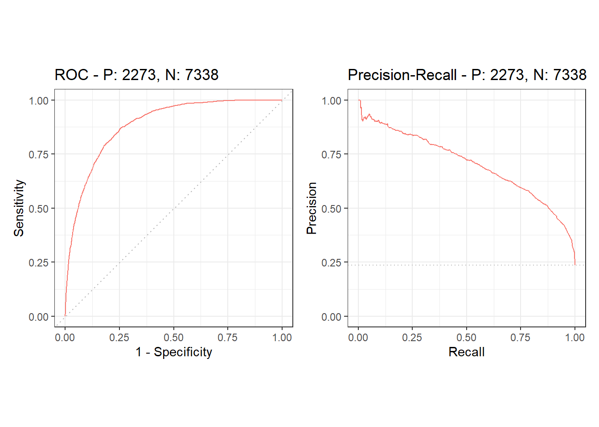

# m6APrediction

**Version 1.0.0 · BIO215 Interim Report 3 · yihui xu**

`m6APrediction` is an R package for scoring candidate RNA
N6-methyladenosine (m6A) sites with the random forest supplied in
BIO215. It combines a five-base sequence context with transcript
annotations, GC content, exon length, distance to a splice junction, and
evolutionary conservation. The package supports both one-site queries
and batch analysis, making it useful for prioritising candidates for
further study.

The fitted model and a 100-row input example are included, so prediction
requires no model training or external data download. The model scores
are random forest positive-class vote proportions, not experimentally
confirmed methylation calls or necessarily calibrated biological
probabilities.

## Installation

R 3.5.0 or later is declared for compatibility with the bundled RDS
format. Dependency versions may require a newer R release. The package
was checked locally using R 4.6.0 on Windows.

### Install from GitHub

Run these commands in the R console. The package includes a fitted model, so the download may take a few minutes.

``` r
install.packages("remotes", repos = "https://cloud.r-project.org")
options(timeout = 900)
remotes::install_github("YihuiXu24/m6APrediction", upgrade = "never")
library(m6APrediction)
```

## Required input features

Each candidate requires the following seven features, without missing
values.

| Feature | Input |
|:---|:---|
| `gc_content` | Numeric GC proportion between 0 and 1. |
| `RNA_type` | `mRNA`, `lincRNA`, `lncRNA`, or `pseudogene`. |
| `RNA_region` | `CDS`, `intron`, `3'UTR`, or `5'UTR`. |
| `exon_length` | Numeric feature already transformed to the log2 scale used in training. |
| `distance_to_junction` | Numeric feature already transformed to the log2 scale used in training. |
| `evolutionary_conservation` | Numeric conservation score on the training-data scale. |
| `DNA_5mer` | Five uppercase DNA bases (`A`, `T`, `C`, `G`) with a central `A`, such as `GGACA`. |

The functions do not apply log transformations. Keep the original course
preprocessing, including how zero values were handled, when supplying
new inputs. Nucleotide positions are categorical predictors with levels
`A`, `T`, `C`, `G`; RNA type and region are also encoded as factors.

## Minimal examples

Both examples are evaluated when this README is rendered. Each loads its
own model, so either can be run independently after installation.

### Predict a batch of sites

``` r
library(m6APrediction)
ml_fit <- readRDS(system.file(
  "extdata", "rf_fit.rds", package = "m6APrediction", mustWork = TRUE
))
feature_df <- read.csv(system.file(
  "extdata", "m6A_input_example.csv",
  package = "m6APrediction", mustWork = TRUE
), stringsAsFactors = FALSE)
batch_result <- prediction_multiple(
  ml_fit, feature_df[1:3, ], positive_threshold = 0.6
)
batch_result[, c("predicted_m6A_prob", "predicted_m6A_status")]
```

      predicted_m6A_prob predicted_m6A_status
    1              0.876             Positive
    2              0.000             Negative
    3              0.498             Negative

`prediction_multiple()` returns the input table plus the numeric
`predicted_m6A_prob` and character `predicted_m6A_status` columns,
retaining row order. `RNA_type` and `RNA_region` are converted to
factors. The supplied example CSV has 100 rows and seven columns; it
demonstrates the interface and is not an independent evaluation dataset.

### Predict one site

``` r
library(m6APrediction)
ml_fit <- readRDS(system.file(
  "extdata", "rf_fit.rds", package = "m6APrediction", mustWork = TRUE
))
single_result <- prediction_single(
  ml_fit,
  gc_content = 0.6,
  RNA_type = "mRNA",
  RNA_region = "CDS",
  exon_length = 12,
  distance_to_junction = 5,
  evolutionary_conservation = 0.8,
  DNA_5mer = "GGACA",
  positive_threshold = 0.5
)
single_result
```

      predicted_m6A_prob predicted_m6A_status 
                  "0.51"           "Positive" 

`prediction_single()` returns a named character vector, because the
score and status share one vector. Convert the score with
`as.numeric(single_result["predicted_m6A_prob"])` if numerical analysis
is needed.

For both functions, a score **strictly greater than**
`positive_threshold` is `Positive`. Equality is `Negative`. The default
threshold is 0.5. The length and distance values in the example are
already on the transformed scale.

## Model performance

In Practical 3 Task 2, I used an 80%/20% train/test split with seed 123.
I fitted a random forest on 38,444 training sites and evaluated it on
9,611 held-out sites. The values below describe that Practical 3 evaluation.
The prediction examples use the separate fitted model supplied with this package.

| Practical 3 test-set metric | Value |
|:----------------------------|------:|
| Test sites | 9,611 |
| Positive / negative sites | 2,273 / 7,338 |
| AUROC | 0.8865734 |
| AUPRC | 0.7049247 |
| Positive-class prevalence (precision-recall baseline) | 23.65% |



## Help and reproducibility

``` r
help("prediction_multiple", package = "m6APrediction")
help("prediction_single", package = "m6APrediction")
example("prediction_multiple", package = "m6APrediction")
example("prediction_single", package = "m6APrediction")
```

All three functions have `.Rd` help files; only the two prediction
functions are exported. Documentation is maintained directly in `man/`,
so the R code contains no comments. Do not regenerate it with `roxygen2`
unless corresponding roxygen documentation is deliberately added.

The package includes regression checks for the reference batch scores,
the single-site result, strict threshold equality, agreement between
single and batch calls, and public exports. Installation, examples, and
tests are checked with `R CMD build` and `R CMD check --no-manual`. The
PDF manual is omitted because it requires a separate LaTeX installation;
the installed help pages are included and checked.

## Author and materials

Author and maintainer: **yihui xu**, <m17725297170@163.com>.

The original functions, fitted model, and example data were supplied in
the BIO215 Practical 6 materials. The performance figure is from the
Practical 3 Task 2 report. This submission packages those teaching
resources and adds documentation, reproducible evaluation figures, and
checks.

License: **MIT**. The `DESCRIPTION` uses the standard R form
`MIT + file LICENSE`, and the source project includes the full license
text in `LICENSE.md`.
