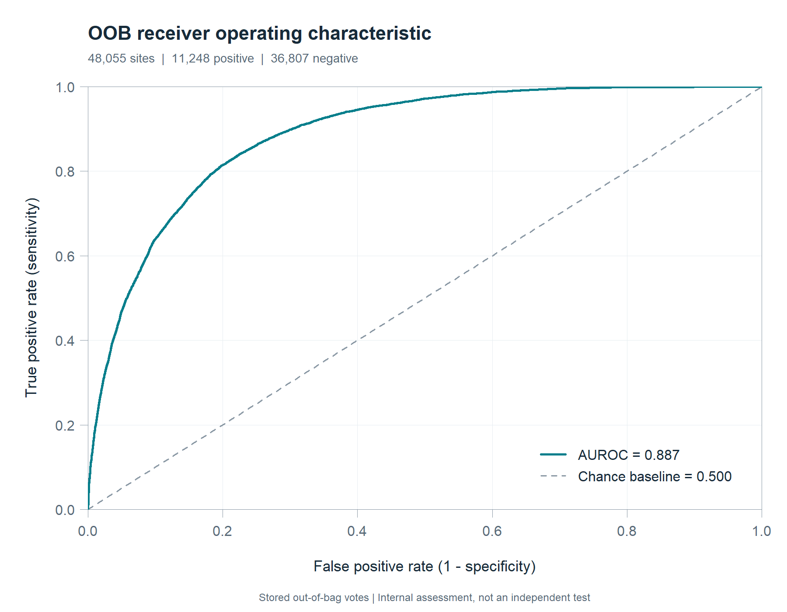
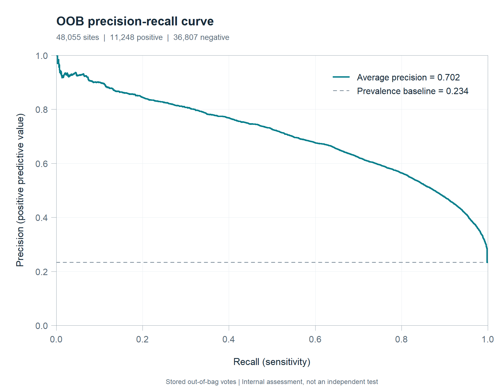

# m6APrediction

**Version 1.0.0 · BIO215 Practical 7 · yihui xu**

`m6APrediction` is an R package for scoring candidate RNA
N6-methyladenosine (m6A) sites with the random forest supplied in
BIO215. It combines a five-base sequence context with transcript
annotations, GC content, exon length, distance to a splice junction, and
evolutionary conservation. The package supports both one-site queries
and batch analysis, making it useful for prioritising candidates for
further study.

The fitted model and a 100-row input example are included, so prediction
requires no model training or external data download. The model scores
are random forest positive-class vote proportions, not experimentally
confirmed methylation calls or necessarily calibrated biological
probabilities.

## Installation

R 3.5.0 or later is declared for compatibility with the bundled RDS
format. Dependency versions may require a newer R release. The package
was checked locally using R 4.6.0 on Windows.

### Install the submitted archive

Download `m6APrediction_1.0.0.tar.gz`, then run the following from its
containing directory. The archive contains the model and both exported
prediction functions.

``` r
install.packages("randomForest", repos = "https://cloud.r-project.org")
install.packages("m6APrediction_1.0.0.tar.gz", repos = NULL, type = "source")
library(m6APrediction)
```

For this project, the archive is saved in
`C:/Users/4Real/Desktop/Project/`. In RStudio, it can also be installed
using **Packages → Install → Package Archive File**.

### Install from GitHub

Install the package directly from GitHub using the following commands.

``` r
install.packages("remotes", repos = "https://cloud.r-project.org")
remotes::install_github("YihuiXu24/m6APrediction")
```

## Required input features

Each candidate requires the following seven features, without missing
values.

| Feature | Input |
|:---|:---|
| `gc_content` | Numeric GC proportion between 0 and 1. |
| `RNA_type` | `mRNA`, `lincRNA`, `lncRNA`, or `pseudogene`. |
| `RNA_region` | `CDS`, `intron`, `3'UTR`, or `5'UTR`. |
| `exon_length` | Numeric feature already transformed to the log2 scale used in training. |
| `distance_to_junction` | Numeric feature already transformed to the log2 scale used in training. |
| `evolutionary_conservation` | Numeric conservation score on the training-data scale. |
| `DNA_5mer` | Five uppercase DNA bases (`A`, `T`, `C`, `G`) with a central `A`, such as `GGACA`. |

The functions do not apply log transformations. Keep the original course
preprocessing, including how zero values were handled, when supplying
new inputs. Nucleotide positions are categorical predictors with levels
`A`, `T`, `C`, `G`; RNA type and region are also encoded as factors.

## Minimal examples

Both examples are evaluated when this README is rendered. Each loads its
own model, so either can be run independently after installation.

### Predict a batch of sites

``` r
library(m6APrediction)
ml_fit <- readRDS(system.file(
  "extdata", "rf_fit.rds", package = "m6APrediction", mustWork = TRUE
))
feature_df <- read.csv(system.file(
  "extdata", "m6A_input_example.csv",
  package = "m6APrediction", mustWork = TRUE
), stringsAsFactors = FALSE)
batch_result <- prediction_multiple(
  ml_fit, feature_df[1:3, ], positive_threshold = 0.6
)
batch_result[, c("predicted_m6A_prob", "predicted_m6A_status")]
```

      predicted_m6A_prob predicted_m6A_status
    1              0.876             Positive
    2              0.000             Negative
    3              0.498             Negative

`prediction_multiple()` returns the input table plus the numeric
`predicted_m6A_prob` and character `predicted_m6A_status` columns,
retaining row order. `RNA_type` and `RNA_region` are converted to
factors. The supplied example CSV has 100 rows and seven columns; it
demonstrates the interface and is not an independent evaluation dataset.

### Predict one site

``` r
library(m6APrediction)
ml_fit <- readRDS(system.file(
  "extdata", "rf_fit.rds", package = "m6APrediction", mustWork = TRUE
))
single_result <- prediction_single(
  ml_fit,
  gc_content = 0.6,
  RNA_type = "mRNA",
  RNA_region = "CDS",
  exon_length = 12,
  distance_to_junction = 5,
  evolutionary_conservation = 0.8,
  DNA_5mer = "GGACA",
  positive_threshold = 0.5
)
single_result
```

      predicted_m6A_prob predicted_m6A_status 
                  "0.51"           "Positive" 

`prediction_single()` returns a named character vector, because the
score and status share one vector. Convert the score with
`as.numeric(single_result["predicted_m6A_prob"])` if numerical analysis
is needed.

For both functions, a score **strictly greater than**
`positive_threshold` is `Positive`. Equality is `Negative`. The default
threshold is 0.5. The length and distance values in the example are
already on the transformed scale.

## Model performance

The following ROC and precision-recall curves use the **stored
out-of-bag (OOB) predictions** of the supplied 500-tree random forest.
Each site’s OOB score is calculated from trees for which that site was
excluded from the bootstrap training sample. These curves provide an
internal model assessment, not performance on an independent external
test set.

The Practical 4 file `m6A_imbalanced.csv` contains 48,055 records, and
its outcome labels and row order match the training response stored in
the model. The Practical 4 guideline also describes it as the data
previously used for modelling. Therefore, predictions on that entire
table are not presented as independent validation. No model was
retrained for this package.

| OOB assessment            |           Value |
|:--------------------------|----------------:|
| Evaluated sites           |          48,055 |
| Positive / negative sites | 11,248 / 36,807 |
| Positive-class prevalence |          23.41% |
| AUROC                     |          0.8873 |
| Average precision (AP)    |          0.7022 |

<figure>

<figcaption aria-hidden="true">ROC curve based on the supplied model’s
OOB predictions.</figcaption>
</figure>

The ROC curve describes the trade-off between true-positive and
false-positive rates. Its dashed diagonal indicates chance
discrimination. AUROC is calculated by trapezoidal integration over the
empirical ROC curve and checked against the rank-sum formulation.

<figure>

<figcaption aria-hidden="true">Precision-recall curve based on the
supplied model’s OOB predictions.</figcaption>
</figure>

The precision-recall curve highlights positive-site retrieval in this
imbalanced dataset. The dashed baseline is the positive-class
prevalence. Average precision (AP) is the sum of each recall increase
multiplied by the corresponding precision, grouping tied scores; it is
not labelled as a trapezoidal PR area.

OOB results depend on the supplied model and its training data. They do
not establish performance on a new organism, assay, or cohort. Training
and tuning provenance beyond the supplied course materials is
unavailable. The package can support candidate prioritisation, but
biological claims require independent validation.

The comment-free script `tools/plot_oob.R` in the source project
reproduces the plots and metrics directly from
`inst/extdata/rf_fit.rds`.

## Help and reproducibility

``` r
help("prediction_multiple", package = "m6APrediction")
help("prediction_single", package = "m6APrediction")
example("prediction_multiple", package = "m6APrediction")
example("prediction_single", package = "m6APrediction")
```

All three functions have `.Rd` help files; only the two prediction
functions are exported. Documentation is maintained directly in `man/`,
so the R code contains no comments. Do not regenerate it with `roxygen2`
unless corresponding roxygen documentation is deliberately added.

The package includes regression checks for the reference batch scores,
the single-site result, strict threshold equality, agreement between
single and batch calls, and public exports. Installation, examples, and
tests are checked with `R CMD build` and `R CMD check --no-manual`. The
PDF manual is omitted because it requires a separate LaTeX installation;
the installed help pages are included and checked.

## Author and materials

Author and maintainer: **yihui xu**, <m17725297170@163.com>.

The original functions, fitted model, and example data were supplied in
the BIO215 Practical 6 materials; the Practical 4 dataset was used to
verify evaluation provenance. This submission packages those teaching
resources and adds documentation, reproducible evaluation figures, and
checks.

License: **MIT**. The `DESCRIPTION` uses the standard R form
`MIT + file LICENSE`, and the source project includes the full license
text in `LICENSE.md`.
